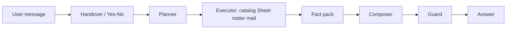

# Architecture status (updated 2026-08-20)

Supersedes the 2026-08-19 “embeddings slipped” snapshot where it conflicts.  
Architecture write-up: **[ASSESSMENT-AND-PLAN.md](./ASSESSMENT-AND-PLAN.md)**.  
Integrations pack: **[ASSESSMENT-HANDOFF.md](./ASSESSMENT-HANDOFF.md)**.

## Mental model

Plan → execute → compose. Gemini picks lookups and words facts. Tools pick verdicts and numbers.



Gemini never chooses in/out of scope or invents prices. Spreadsheet is **read-only**.
Handover and mail confirmation stay rules-only.

## Status board

| Area | Status | Notes |
|---|---|---|
| Catalog / scope verdicts | **Ready** | Lookup from corpus; disagreement asks, does not guess |
| Planner | **Ready** | Gemini structured plan; rule fallback |
| Executor / FactPack | **Ready** | Several lookups per turn |
| Composer + guard | **Ready** | Wording only; invented figures / flipped verdicts discarded |
| Catalog list | **Ready** | Full dump via `list_services`; section and status filters reachable |
| Roster | **Ready** | Sheet `Roster` tab |
| Gemini wording | **Ready** | Developer API key only — **no Vertex** |
| Dense / hybrid RAG | **Ready locally** | `gemini-embedding-001` @ 768; rebuild with `--embed` after corpus changes |
| Budget | **Ready** | Live Google Sheet when `BUDGET_SPREADSHEET_ID` set |
| Quote tiers | **Ready** | Prices from Sheet `Pricing_tiers`; service→tier still JSON |
| Mail | **Ready (test)** | Resend résumé + PDF from audit log; `onboarding@resend.dev` until DNS |
| Contacts | **Temp** | Robin AM / Charlie CM |
| Firestore audit | **Ready** | Dual-write JSONL; planned/satisfied capabilities in the trace |
| Whole-turn eval | **Ready** | `python -m scripts.eval_turns` — 51/51 on rules planner |
| Semantic inventory intent | **Off by default** | Caused identical canned replies; see handoff §10.4 |
| Docker / Cloud Run / IAP / GCS index | **Missing** | |

## Live Sheet tabs

`Branches/countries`, `DB`, `Budget caps`, `Fiscal_calendar`, `Roster`, `Pricing_tiers`  
(Ignored: `Dashboard`, `Scope`)

## Local commands

```powershell
.\.venv\Scripts\python.exe -m uvicorn app.main:app --reload --host 127.0.0.1 --port 8000
.\.venv\Scripts\python.exe -m scripts.ask "what's left for London?" --trace
.\.venv\Scripts\python.exe -m scripts.eval_turns
.\.venv\Scripts\python.exe -m scripts.smoke_sheets
.\.venv\Scripts\python.exe -m scripts.smoke_firestore
```

## Remaining work

1. Production Resend domain  
2. Move service→tier onto Sheet  
3. Confirm merch tier with business  
4. Dockerfile + Cloud Run + secrets + IAP  
5. CI that enforces embedded index  
6. README is current; ASSESSMENT-HANDOFF still describes the pre-planner path in places
